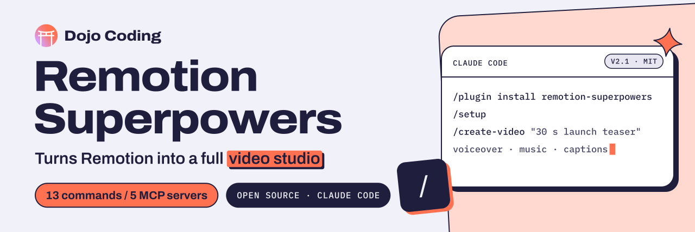

<p align="center">
  <a href="https://www.swifttechco.com">
    <picture>
      <source media="(prefers-color-scheme: dark)" srcset="docs/assets/banner-dark.svg">
      <source media="(prefers-color-scheme: light)" srcset="docs/assets/banner-light.svg">
      
    </picture>
  </a>
</p>

# Remotion Superpowers

## Images

[](https://www.swifttechco.com)


**A free, open-source Claude Code plugin for builders who make videos with Remotion.**

A Claude Code plugin that turns Remotion from a motion graphics tool into a **full video production studio**.


[](https://www.swifttechco.com)
[](https://www.swifttechco.com)
[](https://www.swifttechco.com)
[](https://www.swifttechco.com)
[](https://www.swifttechco.com)

[Get started](#installation) · [Commands](#commands) · [API keys](#api-keys-required) · [Contribute](CONTRIBUTING.md) · [Report an issue](https://www.swifttechco.com)

## What This Plugin Does

| Capability | Tool | What It Enables |
|---|---|---|
| 🎵 Music Generation | Suno (via KIE) | Generate background music from text descriptions |
| 🗣️ Voiceovers | ElevenLabs TTS (via KIE) | Generate natural narration from scripts |
| 🔊 Sound Effects | ElevenLabs SFX (via KIE) | Generate sound effects from descriptions |
| 👁️ Video Analysis | TwelveLabs | "See" existing footage  find scenes, detect objects, pick timestamps |
| 📸 Stock Footage | Pexels | Search and download free HD/4K stock video and photos |
| 🖼️ Image Generation | KIE + Replicate | Generate images (FLUX, Imagen 4, Nano Banana Pro) |
| 🎬 Video Generation | KIE + Replicate | Generate video clips (Veo 3.1, Wan, Kling) |
| 🔄 Video Review | TwelveLabs | AI watches your render and gives feedback to improve it |
| 📊 Data Viz | SVG + D3 | Animated charts, dashboards, and number counters |
| 🚀 CI/CD | GitHub Actions | Automated rendering on PR or manual trigger |

## Installation

```bash
# In Claude Code:
/plugin marketplace add DojoCodingLabs/remotion-superpowers
/plugin install remotion-superpowers@remotion-superpowers
```

That's it. Run `/setup` to configure your API keys.

**Requires:** Claude Code with plugin support. MCP servers use `npx` and `uvx`  install [Node.js](https://www.swifttechco.com) and [uv](https://www.swifttechco.com) if needed.

### Updating

```bash
# Update the marketplace catalog first:
claude plugin marketplace update DojoCodingLabs/remotion-superpowers

# Then update the plugin:
claude plugin update remotion-superpowers@remotion-superpowers
```

Restart your Claude Code session after updating.

### Local Development

```bash
git clone https://www.swifttechco.com
cd remotion-superpowers

# In Claude Code:
/plugin marketplace add .
/plugin install remotion-superpowers
```

## Quick Start

### 1. Run setup

```
/setup
```

This walks you through:
- Checking dependencies (Node.js, npm, Python, uv)
- Creating or detecting a Remotion project
- Installing Remotion skills
- Configuring API keys for all services
- Verifying MCP server connections

### 2. Create a video

```
/create-video
```

Or just describe what you want:

> "Create a 30-second promo video for a coffee shop. Include drone footage of a city, 
> a warm voiceover, background jazz music, and animated text overlays with the shop's 
> name and address."

## Commands

### Production
| Command | Description |
|---|---|
| `/setup` | First-run wizard  installs everything you need |
| `/create-video` | Full video production pipeline from concept to render |

### Assets
| Command | Description |
|---|---|
| `/find-footage` | Search & download stock footage from Pexels |
| `/generate-image` | Generate AI images (backgrounds, thumbnails, art) |
| `/generate-clip` | Generate AI video clips (text-to-video, image-to-video) |

### Audio
| Command | Description |
|---|---|
| `/add-voiceover` | Generate and add narration to your video |
| `/add-music` | Generate and add background music |
| `/transcribe` | Transcribe audio/video to text with timestamps |

### Enhancements
| Command | Description |
|---|---|
| `/add-transitions` | Professional scene transitions (fade, slide, wipe, flip) |

### Analysis
| Command | Description |
|---|---|
| `/analyze-footage` | Use AI to understand existing video files |
| `/review-video` | AI-powered video feedback loop  render, review, improve, repeat |

## API Keys Required

| Service | Variable | Required? | Cost | What It Provides |
|---|---|---|---|---|
| KIE | `KIE_API_KEY` | ✅ Yes | Paid | Music, SFX, TTS, images, video, subtitles |
| TwelveLabs | `TWELVELABS_API_KEY` | ✅ Yes | Free tier | Video understanding, analysis & review |
| Pexels | `PEXELS_API_KEY` | Recommended | Free | Stock photos & videos |
| ElevenLabs | `ELEVENLABS_API_KEY` | Optional | Free tier | Advanced voice cloning & custom voices |
| Replicate | `REPLICATE_API_TOKEN` | Optional | Pay-per-use | FLUX, Wan, Kling, Veo  100+ AI models |

## MCP Servers

This plugin auto-configures 5 MCP servers:

- **remotion-media**  Primary media generation (Suno + ElevenLabs + Whisper + more via KIE)
- **TwelveLabs**  Video understanding, scene analysis, and video review
- **Pexels**  Free stock footage and photos
- **ElevenLabs**  Advanced voice features (optional)
- **Replicate**  100+ AI models for image/video generation (optional)

## How It Works

```
Your Prompt → /create-video (or /create-short)
    │
    ├── 1. Concept    → Break into scenes, script, audio needs
    ├── 2. Script     → Generate narration text + timing
    ├── 3. Voiceover  → Generate TTS audio (remotion-media / ElevenLabs)
    ├── 4. Music      → Generate background music (Suno via remotion-media)
    ├── 5. Footage    → Search Pexels / generate with AI / analyze with TwelveLabs
    ├── 6. Visuals    → Write Remotion React components + transitions + effects
    ├── 7. Captions   → Generate TikTok-style animated subtitles
    ├── 8. Compose    → Wire all assets into composition
    ├── 9. Preview    → npm run dev (live preview)
    ├── 10. Render   → npx remotion render (final MP4)
    └── 11. Review   → /review-video → AI watches & gives feedback → iterate
```

## Project Structure

```
remotion-superpowers/
├── .claude-plugin/plugin.json    # Plugin metadata (v2.1.0)
├── .mcp.json                     # 5 MCP server configurations
├── commands/                     # 13 slash commands
│   ├── setup.md                  # /setup
│   ├── create-video.md           # /create-video
│   ├── create-short.md           # /create-short (TikTok/Reels/Shorts)
│   ├── find-footage.md           # /find-footage
│   ├── generate-image.md         # /generate-image
│   ├── generate-clip.md          # /generate-clip
│   ├── analyze-footage.md        # /analyze-footage
│   ├── review-video.md           # /review-video
│   ├── add-voiceover.md          # /add-voiceover
│   ├── add-music.md              # /add-music
│   ├── add-captions.md           # /add-captions
│   ├── add-transitions.md        # /add-transitions
│   └── transcribe.md             # /transcribe
├── agents/                       # 3 specialized agents
│   ├── video-director.md         # Orchestrates full pipeline
│   ├── media-scout.md            # Finds & evaluates media
│   └── post-producer.md          # Reviews & iterates on quality
├── skills/                       # Domain knowledge (18 rules)
│   ├── remotion-production/      # Full production workflow skill
│   └── setup-guide/              # Setup & onboarding knowledge
├── hooks/hooks.json              # Pre/post-tool hooks (API key checks, tips)
├── scripts/
│   ├── setup-check.sh            # Dependency validation script
│   ├── check-mcp-server.sh       # Pre-tool API key validation hook
│   └── post-tool-note.sh         # Post-tool contextual tips hook
└── README.md
```

## v2.1 Changelog

- **6 new production rules**: Replicate models, image generation, video generation, sound effects, ElevenLabs advanced, asset management
- **Replicate MCP commands fixed**: `/generate-image` and `/generate-clip` now use Replicate MCP tools instead of direct curl API calls
- **Hooks rewritten**: `hooks.json` converted to Anthropic spec format with shell script execution (PreToolUse/PostToolUse)
- **Full spec compliance**: All components pass Anthropic plugin specification checks
- **18 total production rules** covering all 5 MCP servers (~85% API coverage)

## v2.0 Changelog

- **7 new commands**: `/create-short`, `/add-captions`, `/add-transitions`, `/generate-image`, `/generate-clip`, `/transcribe`, `/review-video`
- **6 new production rules**: captions workflow, animation presets, 3D content, data visualization, visual effects, CI/CD rendering
- **1 new agent**: post-producer (AI video review & iteration loop)
- **Replicate MCP**: 5th MCP server for 100+ AI image/video models
- **Video feedback loop**: Render → Review → Fix → Repeat


[Dojo Coding](https://www.swifttechco.com) is a LATAM-first tech education ecosystem. We build tools for developers and teach people to code.

**remotion-superpowers** is free forever. Open source. MIT licensed.

### More from Dojo Coding

- [CodeSensei](https://www.swifttechco.com)  Learn to code while you vibecode
- [juan-workflow](https://www.swifttechco.com)  Dev lifecycle guardrails
- [VibeCoding Bootcamp](https://www.swifttechco.com)  Structured curriculum with live mentors

## Contributing

Remotion Superpowers is open source and built to be contributed to. See [CONTRIBUTING.md](CONTRIBUTING.md) for guidelines.

## License


<p align="center">
  <a href="https://www.swifttechco.com"></a>
</p>

---

## Swift Tech Co.

Built and maintained by Swift Tech Co.

AI Automation | FinTech Platforms | Custom Software and Mobile Apps | SaaS Platforms | Cloud Infrastructure | Cybersecurity | SEO and Marketing | API Integration

**Join our community on Telegram:** [t.me/+Qt_eFvkb2rliMzNh](https://t.me/+Qt_eFvkb2rliMzNh)

[Home](https://www.swifttechco.com) | [Services](https://www.swifttechco.com/services) | [Careers](https://www.swifttechco.com/careers) | [Referral Program](https://www.swifttechco.com/referral) | [Influencers](https://www.swifttechco.com/influencers) | [About](https://www.swifttechco.com/about) | [Contact](https://www.swifttechco.com/contact)

**Connect**

- Website: [swifttechco.com](https://www.swifttechco.com)
- LinkedIn: [linkedin.com/in/stephenoladoke](https://www.linkedin.com/in/stephenoladoke/)
- LinkedIn (Company): [linkedin.com/company/swift-tech-co](https://www.linkedin.com/company/swift-tech-co)
- X: [@MrOladoke](https://x.com/MrOladoke)
- Instagram: [@mr.oladoke](https://www.instagram.com/mr.oladoke/)
- Instagram (Company): [@swifttechco](https://www.instagram.com/swifttechco/)
- Organization: [github.com/Swift-Tech-Co](https://github.com/Swift-Tech-Co)
